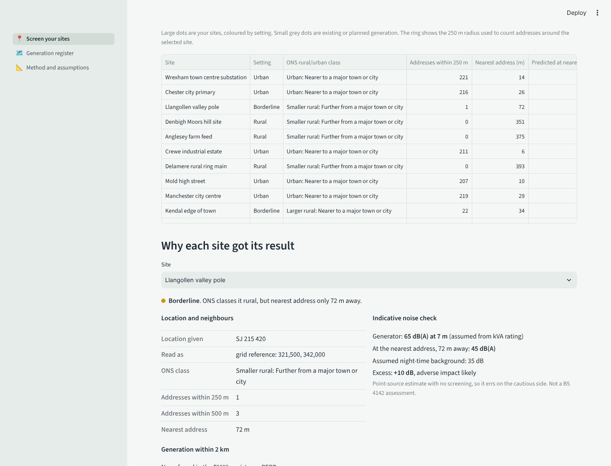

# Generator site screening

A tool for network operators placing **temporary or standby generators**. Upload a list of
candidate sites (CSV or Excel, in whatever layout your team uses) and get back, for every
site:

- its **setting** (rural, borderline or urban) from the ONS 2021 Rural Urban
  Classification and the number of addresses nearby;
- the **distance to the nearest address** and the count within 250 m and 500 m;
- an **indicative noise check**: predicted level at the nearest address against a typical
  background, banded the BS 4142 way;
- the **generation already connected or planned within 2 km**, from the DNO Embedded
  Capacity Register and REPD;
- the **reason** for every result, and a spreadsheet to attach to your own assessment.

> **Live app:** _add your Streamlit link here after deploying_
>
> Screening only. It does not replace a BS 4142 assessment or your organisation's policy.
> The defaults are documented assumptions and can be changed per run.



_Screenshot uses synthetic reference data while the real ONS and OS files are being added._

## Using it

1. Open the app and upload your site list, or switch on the example sites to see how it
   works.
2. Check the column mapping. The location can be a postcode, OS grid reference, easting
   and northing, or latitude and longitude, and can differ from row to row.
3. Adjust the rules if your organisation uses different thresholds.
4. Download the results. The workbook has the results, the rows that could not be
   screened and why, and the assumptions used.

### Using it with internal data

Run it on your own machine so nothing leaves your network:

```bash
pip install -r requirements.txt
streamlit run app/streamlit_app.py
```

To use a different set of reference data (for example your own register of assets),
point `GBEG_REFERENCE` at a folder with the same file layout as `app/data/reference`.

## How it works

```
your site list ──► read & detect columns ──► locate each site (OSGB36 + WGS84)
                                                   │
       ONS 2021 rural/urban areas ─────────────────┤ point in polygon
       OS Open UPRN addresses ─────────────────────┤ nearest + counts (k-d tree)
       ENWL register + REPD (pipeline below) ──────┤ generation within 2 km
                                                   ▼
                         rules (config/screening.yaml) ──► results, map, Excel report
```

Method, formulas and limitations: [docs/screening-method.md](docs/screening-method.md).

### The generation pipeline behind it

Existing generation comes from a data pipeline that reconciles the DNO Embedded Capacity
Register with the government's Renewable Energy Planning Database. The two registers
describe the same sites differently: different names, units, status vocabularies and
locations up to 2 km apart. The pipeline:

- stages each source with explicit data quality fixes (swapped coordinates, sentinel
  values, free-text technology labels), and fails the load on any label it has not seen;
- matches records on technology, capacity, distance and site-name similarity;
- measures match accuracy on a stratified, hand-labelled sample.

Every decision and data problem found is recorded in
[docs/decision-log.md](docs/decision-log.md). The app's **Generation register** page shows
the result.

## Setting up the reference data

The large national files are downloaded once and cut down to the region:

```bash
pip install -e ".[dev]"

# ONS output areas with the 2021 rural/urban classification (BGC boundaries)
python -m gbeg.screening.prepare ruc       path/to/Output_Areas_2021_BGC_RUC.gpkg
# OS Open UPRN (CSV or zip)
python -m gbeg.screening.prepare addresses path/to/osopenuprn.zip
# OS Code-Point Open (zip), for postcode lookups
python -m gbeg.screening.prepare postcodes path/to/codepo_gb.zip

# Existing generation: run the pipeline, then export
python -m gbeg.ingest.repd     data/raw/repd/<release>/<file>.csv
python -m gbeg.ingest.ecr_enwl data/raw/ecr_enwl/<release>/<file>.csv
python -m gbeg.screening.prepare generation
python -m gbeg.export          # data for the Generation register page
```

To look up **SPEN substations by name**, download "Capacity Heatmaps Information Model SPM"
as CSV from the SP Energy Networks Open Data Portal (free account needed), then:

```bash
python -m gbeg.screening.prepare spen-sites path/to/distribution-capacity-heatmaps-spm.csv
```

A site with no location whose name matches a substation is then placed at that
substation, and the Screen page offers a substation picker.

Coverage in this version: North West England, Cheshire, Merseyside and North Wales.

## Repository layout

```
app/                Streamlit app (screening, register, method pages)
config/             screening rules, technology mappings, source registry
src/gbeg/screening/ input reading, reference layers, rules, Excel report, data prep
src/gbeg/ingest/    source loaders (REPD, ENWL ECR)
src/gbeg/           matching pipeline, labelling and evaluation, export
tests/              pytest suite
docs/               method, decision log, schema, roadmap
```

## Data sources and licences

ONS Rural Urban Classification 2021; OS Open UPRN; OS Code-Point Open; DESNZ Renewable
Energy Planning Database; Electricity North West Embedded Capacity Register;
SP Energy Networks Open Data Portal (CC BY 4.0), when the substation list is used.
Contains OS data © Crown copyright and database right. Contains public sector information
licensed under the Open Government Licence v3.0. Basemap © CARTO, © OpenStreetMap
contributors.

## Author

Jax, data engineer, energy sector.
